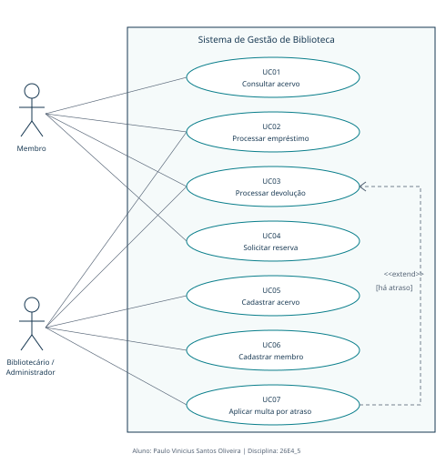

# TP1 | Biblioteca Universitária

Projeto de Bloco - Análise, modelagem e protótipo standalone

## Identificação

Aluno: Paulo Vinicius Santos Oliveira
Código da disciplina: 26E4_5
Trilha escolhida: Java 21
Data: 16/11/2026
Versão: 1.0

## 1. Objetivo e domínio

Especificar um sistema de gestão de biblioteca universitária, com acervo, exemplares físicos, membros, empréstimos, devoluções, reservas e multas. A documentação descreve o domínio a desenvolver durante o bloco; o código desta entrega é apenas um protótipo procedural em console.

## 2. Atores

Membro: aluno, professor ou funcionário. Consulta o acervo e solicita empréstimo, devolução e reserva. Bibliotecário/Administrador: cadastra acervo e membros, processa empréstimos e devoluções e aplica multas por atraso.

## 3. Critério de classificação

RF identifica comportamentos observáveis; RNF identifica atributos de qualidade e restrições técnicas; RN identifica regras de negócio. H identifica hipóteses adotadas para preencher lacunas do enunciado. Requisitos do sistema completo não significam implementação integral no TP1.

## Resumo da entrega

Inclui requisitos, diagrama UML, quatro casos de uso detalhados, escopo, hipóteses, instruções de ambiente, protótipo Java e registro de verificações. Cadastros reais, orientação a objetos, banco de dados, API, autenticação e publicação web ficam para etapas posteriores.

# 4. Requisitos funcionais

| ID | Classificação | Descrição | Caso de uso |
| --- | --- | --- | --- |
| RF01 | Cadastro | Cadastrar livros com título, autor e ISBN. | UC05 |
| RF02 | Cadastro | Cadastrar exemplares com patrimônio, conservação e vínculo obrigatório a um livro. | UC05 |
| RF03 | Cadastro | Cadastrar membros com nome, matrícula e tipo: aluno, professor ou funcionário. | UC06 |
| RF04 | Consulta | Consultar livros por título, autor ou ISBN e visualizar exemplares e disponibilidade. | UC01 |
| RF05 | Circulação | Processar empréstimo de um exemplar para um membro, registrando retirada e prazo de devolução. | UC02 |
| RF06 | Circulação | Verificar disponibilidade e limite de empréstimos antes de autorizar a retirada. | UC02 |
| RF07 | Circulação | Processar devolução, registrar a data efetiva e encerrar o empréstimo ativo. | UC03 |
| RF08 | Financeiro | Calcular e registrar multa quando a devolução ocorrer após o prazo. | UC07 |
| RF09 | Reserva | Registrar reserva com livro, membro e data, verificando a situação do exemplar de referência. | UC04 |
| RF10 | Consulta | Exibir os empréstimos ativos do membro para apoiar o controle do limite. | UC02 |
| RF11 | Validação | Recusar operações inválidas com motivo claro, sem registrar operação parcial. | UC02/03/04 |

Os requisitos funcionais cobrem o sistema planejado. No TP1, RF04 a RF09 aparecem apenas em recortes demonstrativos, conforme o detalhamento dos casos de uso e a seção de escopo.

# 5. Qualidade e restrições

| ID | Classificação | Requisito não funcional |
| --- | --- | --- |
| RNF01 | Restrição técnica | O protótipo deve executar localmente em Java 21 pelo terminal; utilizar IntelliJ IDEA Community conforme o enunciado. |
| RNF02 | Restrição de implementação | Usar programação procedural no TP1, sem classes de domínio, herança, interfaces próprias ou frameworks. |
| RNF03 | Usabilidade | Exibir menu numerado, opção de saída e mensagens em português; retornar ao menu após cada tentativa. |
| RNF04 | Confiabilidade | Tratar opções inválidas e entradas fora dos intervalos aceitos, sem encerrar por erro de conversão. |
| RNF05 | Desempenho proposto | Meta a validar: responder em até 2 segundos às simulações locais, após a confirmação dos dados; sem carga concorrente no TP1. |
| RNF06 | Manutenibilidade | Manter fonte UTF-8 e pastas docs/ e src/; documentar execução, regras e hipóteses, sem dependências externas. |
| RNF07 | Segurança futura | Na evolução web, restringir cadastros e processamento ao bibliotecário/administrador e permitir ao membro suas consultas e solicitações. Autenticação fora do TP1. |

## 6. Regras de negócio

| ID | Regra |
| --- | --- |
| RN01 | Prazo padrão de empréstimo: 14 dias para todos os tipos de membro. |
| RN02 | Multa calculada por dia corrido de atraso; não excluir fins de semana ou feriados. |
| RN03 | Cada membro pode manter no máximo 3 empréstimos simultaneamente ativos. |
| RN04 | Um exemplar não pode ter dois empréstimos ativos ao mesmo tempo. |
| RN05 | Só autorizar reserva se o exemplar de referência estiver emprestado no momento da solicitação. |
| RN06 | Devolução no prazo não gera multa; empréstimo devolvido deixa de contar para o limite. |

# 7. Entidades e vínculos

| Entidade | Dados e significado |
| --- | --- |
| Livro | Título, autor, ISBN. Representa a obra/edição; um livro pode ter vários exemplares. |
| Exemplar | Patrimônio, conservação e vínculo com Livro. Representa a unidade física emprestável. |
| Membro | Nome, matrícula e tipo. Pode realizar vários empréstimos e reservas ao longo do tempo. |
| Empréstimo | Exemplar, membro, data de retirada e prazo de devolução. Data efetiva da devolução proposta para identificar o encerramento. |
| Reserva | Livro, membro e data. A checagem de elegibilidade usa um exemplar de referência emprestado, sem transformar a reserva em alocação definitiva desse exemplar. |
| Multa (registro proposto) | Vínculo ao empréstimo, dias de atraso e valor calculado. Não há cobrança por gateway nem pagamento no TP1. |

## Relacionamentos conceituais

Livro 1:N Exemplar; Membro 1:N Empréstimo; Exemplar 1:N Empréstimo no histórico, com no máximo um ativo; Livro 1:N Reserva; Membro 1:N Reserva. O limite de três empréstimos vale apenas para os ativos. O registro proposto de multa vincula-se ao empréstimo que gerou o atraso.

Este levantamento não é um diagrama de classes nem antecipa implementação orientada a objetos. Ele esclarece o significado dos dados para evitar confundir a obra com sua unidade física.

# 8. Diagrama de casos de uso UML

Fonte editável: casos_de_uso.puml.

Linhas contínuas representam associações entre atores e casos de uso. UC07 estende UC03 somente quando há atraso: a seta tracejada aponta para o caso base, Processar devolução. UC05 e UC06 estão modelados para o projeto completo e não implementados no protótipo.

# UC01 | Consultar acervo

## Atores

Membro

## Rastreabilidade

RF04

## Pré-condições

Nenhuma autenticação exigida para a consulta no modelo inicial.

## Gatilho

Membro informa título, autor ou ISBN.

## Fluxo principal

1. O membro informa um critério de busca.

2. O sistema procura livros correspondentes.

3. O sistema exibe título, autor, ISBN e exemplares com suas situações.

## Fluxos alternativos

A1 - Nenhum resultado: o sistema informa que nenhum livro foi encontrado e permite nova busca.

## Pós-condição

Acervo consultado; nenhum registro alterado.

## Recorte no protótipo TP1

A opção 1 mostra apenas um registro fictício fixo, sem busca.

# UC02 | Processar empréstimo

## Atores

Bibliotecário/Administrador (principal); Membro (solicitante)

## Rastreabilidade

RF05, RF06, RF10, RF11; RN01, RN03, RN04

## Pré-condições

Membro e exemplar cadastrados. Bibliotecário identificado no sistema completo.

## Gatilho

Membro solicita um exemplar ao bibliotecário.

## Fluxo principal

1. O bibliotecário identifica o membro e o exemplar solicitado.

2. O sistema verifica que o membro tem menos de 3 empréstimos ativos.

3. O sistema confirma que o exemplar está disponível.

4. O sistema registra retirada e prazo de 14 dias, vincula membro e exemplar e marca o empréstimo como ativo.

5. O sistema informa a confirmação e o prazo de devolução.

## Fluxos alternativos

A1 - Membro já possui 3 empréstimos ativos: negar com explicação e não criar empréstimo.

A2 - Exemplar indisponível: negar com explicação e não alterar registros.

A3 - Membro ou exemplar inexistente: informar o problema e solicitar identificação válida.

## Pós-condição

Empréstimo ativo criado e exemplar emprestado, ou operação recusada sem alteração.

## Recorte no protótipo TP1

A opção 2 valida quantidade e disponibilidade informadas pelo usuário e mostra total simulado e prazo; não registra datas ou cadastros.

# UC03 | Processar devolução

## Atores

Bibliotecário/Administrador (principal); Membro (solicitante)

## Rastreabilidade

RF07, RF08, RF11; RN02, RN06

## Pré-condições

Existência de empréstimo ativo do exemplar devolvido.

## Gatilho

Membro entrega o exemplar ao bibliotecário.

## Fluxo principal

1. O bibliotecário identifica o empréstimo do exemplar.

2. O sistema registra a data efetiva da devolução.

3. O sistema compara a devolução com o prazo.

4. Sem atraso, o sistema encerra o empréstimo sem multa e libera o exemplar para o fluxo de disponibilidade.

5. O sistema confirma a devolução e atualiza a quantidade de empréstimos ativos.

## Fluxos alternativos

A1 - Há atraso: executar UC07 (aplicar multa), registrar valor e encerrar o empréstimo. A multa não impede receber a devolução nesta proposta.

A2 - Empréstimo ativo não encontrado: informar a inconsistência e não registrar devolução.

## Pós-condição

Empréstimo encerrado, com multa registrada se houver atraso, ou tentativa recusada.

## Recorte no protótipo TP1

A opção 3 recebe existência de empréstimo e dias de atraso; calcula valor, sem atualizar registros. Disponibilização e fila futura não são implementadas.

# UC04 | Solicitar reserva

## Atores

Membro

## Rastreabilidade

RF09, RF11; RN05

## Pré-condições

Membro e livro cadastrados; exemplar de referência identificável.

## Gatilho

Membro solicita reserva de um livro.

## Fluxo principal

1. O membro informa o livro desejado e o exemplar de referência.

2. O sistema confirma que o exemplar pertence ao livro e está emprestado naquele momento.

3. O sistema registra uma reserva vinculada ao livro e ao membro, com a data da solicitação.

4. O sistema confirma a solicitação.

## Fluxos alternativos

A1 - Exemplar não está emprestado: recusar reserva e explicar a regra.

A2 - Livro, membro ou exemplar não encontrado, ou exemplar pertence a outro livro: informar erro e não registrar reserva.

## Pós-condição

Reserva registrada, ou solicitação recusada sem alteração.

## Recorte no protótipo TP1

A opção 4 valida apenas a condição emprestado; não identifica livro/membro, não armazena reserva e não implementa fila.

# 9. Hipóteses e decisões pendentes

## H01 | Tarifa não definida

Adotar R$ 1,00 por dia apenas na simulação. A tarifa real deve ser definida pelo professor antes da implementação completa.

## H02 | Reserva: livro ou exemplar

Manter a entidade Reserva vinculada a Livro e Membro. Usar exemplar de referência para validar RN05. Confirmar como tratar livro com outro exemplar disponível.

## H03 | Datas

No modelo futuro, prazo = data de retirada + 14 dias; atraso = máximo entre zero e a diferença em dias entre devolução e prazo. A devolução no próprio vencimento não gera multa. No TP1, os dias são informados manualmente.

## H04 | Identificadores

Propor ISBN único por edição, patrimônio único por exemplar e matrícula única por membro. Essas unicidades devem ser validadas com o professor.

## H05 | Conservação

Registrar conservação como dado descritivo. Não bloquear empréstimo por conservação sem uma política definida.

## H06 | Políticas não informadas

Não presumir bloqueio por multa, renovação, prioridade de professor, fila de reservas, prazo de retirada, cancelamento ou limite de reservas. Adiar até definição.

## H07 | Dados e limites da simulação

Usar um livro fictício para consulta e entradas independentes por operação; nada é cadastrado ou armazenado. Aceitar atraso entre 0 e 36500 dias como limite técnico didático, não regra da biblioteca.

## H08 | Papéis

Agrupar bibliotecário e administrador em um papel, conforme o enunciado. Membro solicita retirada/devolução e bibliotecário as processa; não são operações de autoatendimento no modelo completo.

# 10. Justificativa do escopo

## Dentro do TP1

Análise do domínio, requisitos classificados, regras e hipóteses explícitas, diagrama UML com dois papéis, descrição de quatro cenários e um programa local simples. O protótipo demonstra consulta fixa, decisão de empréstimo, cálculo de multa e condição de reserva, usando int, double, boolean, operadores, if/else, switch e while.

## Adiado para os próximos TPs

Classes de domínio, coleções de cadastros, persistência, datas reais, atualização consistente dos estados, fila de reservas, testes de integração, API, Spring Boot, autenticação e implantação. A justificativa é manter esta entrega no nível procedural solicitado e definir primeiro as regras que sustentarão a evolução do sistema.

## Limitações deliberadas

Cada operação é independente e usa dados informados pelo operador. Autorizar uma simulação não altera o acervo demonstrativo, não cria empréstimo e não armazena reserva. O atraso é digitado, e não calculado por calendário. A classe Main e o uso de Scanner/String são necessários à execução Java; não representam modelagem orientada a objetos do domínio.

## Pontos para validar com o professor

Confirmar tarifa diária e regras para reservas quando há vários exemplares; confirmar unicidade dos identificadores, políticas sobre conservação, multas pendentes e reservas; aprovar meta de desempenho e escopo procedural. Nenhuma dessas decisões é apresentada como já aprovada.

## Uso de IA

Esta versão inicial do documento e do código foi gerada com apoio de IA a pedido do aluno. O enunciado orienta usar IA para explicar e revisar o código escrito pelo aluno. Portanto, esta versão deve ser estudada, adaptada e discutida com o professor quanto à forma de uso permitida; não se declara autoria independente nem revisão pessoal ainda não realizada.

# 11. Ambiente e execução

Trilha fixada para o bloco: Java. Ambiente solicitado: JDK 21 LTS e IntelliJ IDEA Community Edition. A instalação no computador do aluno e a evidência visual do IDE devem ser confirmadas pelo próprio aluno; este documento não atesta uma configuração que não foi observada.

## Configurar o projeto

1. Instalar o JDK 21 e confirmar java -version e javac -version no terminal.

2. No IntelliJ, criar um projeto Java com SDK 21 e sistema de build IntelliJ, ou abrir a pasta e marcar src como Sources Root.

3. Copiar src/Main.java para src; usar UTF-8 e executar Main.main pelo botão de execução.

4. No terminal, a partir da raiz do projeto: criar a pasta out; compilar com javac -encoding UTF-8 --release 21 -d out src/Main.java; executar com java -cp out Main.

## Comprovação de execução realizada

O código foi compilado e executado neste ambiente de preparação com OpenJDK 21.0.13. Como o executável javac não estava exposto no PATH, o compilador do JDK foi invocado com java com.sun.tools.javac.Main. Foram exercitados os fluxos normais, as recusas por regras e entradas inválidas. O registro completo está em docs/verificacao.md; isso não substitui a demonstração no computador do aluno.

## Referências técnicas consultadas

Enunciado do TP1 fornecido pelo aluno: domínio, regras e entregáveis.
Oracle, The java Command - Java SE 21: https://docs.oracle.com/en/java/javase/21/docs/specs/man/java.html
JetBrains, Run a Java application: https://www.jetbrains.com/help/idea/run-java-applications.html
Consulta: 16/11/2026. Usar o JDK 21 solicitado, mesmo que exemplos atuais do fabricante mostrem versões posteriores.
